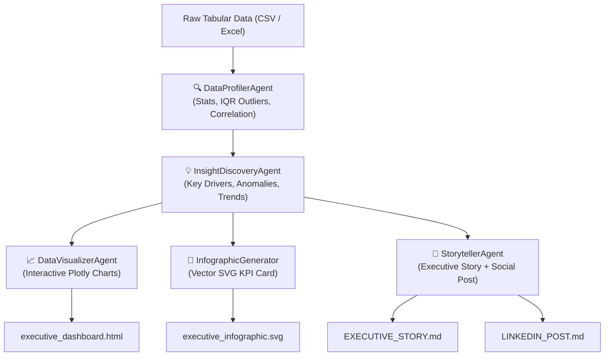

# 📊 Agentic Data Storyteller

[](https://github.com/NiteshBen/agentic-data-storyteller/actions)
[](https://www.python.org/downloads/)
[](https://opensource.org/licenses/MIT)
[](https://github.com/psf/black)

> **Autonomous Multi-Agent Business Intelligence & Data Storytelling Engine**  
> Translates raw tabular datasets (CSV, Excel, SQL) into interactive glassmorphic visual dashboards, statistical insight reports, and executive social infographic cards.

---

## 🌟 Overview

Modern decision-makers are inundated with numbers, raw spreadsheets, and static charts. They lack the time to dig through columns to answer: *"What happened, why does it matter, and what action should we take?"*

**Agentic Data Storyteller** solves this by deploying a collaborative team of specialized autonomous agents in Python:
1. **🔍 DataProfilerAgent**: Computes statistical summaries, missingness, schema types, correlation matrices, and IQR outlier boundaries.
2. **💡 InsightDiscoveryAgent**: Detects high-leverage business drivers, multivariate correlations, anomalies, and categorical concentrations.
3. **📈 DataVisualizerAgent**: Assembles interactive Plotly visual charts into a standalone, dark glassmorphic HTML executive dashboard.
4. **🎨 InfographicGenerator**: Crafts high-resolution, vector SVG social summary cards ready for executive briefs and LinkedIn posts.
5. **📝 StorytellerAgent**: Synthesizes statistical findings into an actionable executive briefing (`EXECUTIVE_STORY.md`) and pre-formatted LinkedIn announcements.

---

## 🏗️ Architecture



---

## 🚀 Key Features

- **100% Offline Capability**: Runs completely local and deterministic without requiring external paid API keys.
- **Pluggable Gemini LLM Support**: Set `GEMINI_API_KEY` to enable Google GenAI Gemini 2.5 Flash for enriched natural language narrative synthesis.
- **Interactive Plotly Visualizations**:
  - Category Volume Distribution (Color scaled)
  - Multivariate Correlation Heatmaps
  - Continuous Feature Distribution with Marginal Box Plots
  - Temporal Trajectory & Moving Averages
- **Vector SVG Infographic Cards**: 1200x630 cards engineered for GitHub READMEs, slide decks, and LinkedIn link previews.
- **Ready for Social Sharing**: Formulates formatted LinkedIn posts and provides a 1-click sharing utility (`share_to_linkedin.py`).

---

## 📂 Project Structure

```
agentic-data-storyteller/
├── artifacts/                           # Generated dashboards and reports
│   ├── executive_dashboard.html         # Interactive HTML report
│   ├── executive_infographic.svg        # 1200x630 SVG summary card
│   ├── EXECUTIVE_STORY.md               # Executive briefing markdown
│   └── LINKEDIN_POST.md                 # Ready-to-publish social post
├── data/
│   └── sample_ecommerce_sales.csv       # Sample e-commerce dataset
├── src/agentic_data_storyteller/
│   ├── agents/
│   │   ├── profiler_agent.py            # Statistical profiling
│   │   ├── insight_agent.py             # Pattern recognition
│   │   ├── visualizer_agent.py          # Plotly dashboard generation
│   │   └── storyteller_agent.py         # Narrative synthesis
│   ├── models/
│   │   └── schema.py                    # Typed dataclasses
│   ├── utils/
│   │   ├── infographic_generator.py     # SVG visual card builder
│   │   └── llm_bridge.py                # Gemini API integration
│   ├── orchestrator.py                  # Multi-agent coordination
│   └── cli.py                           # CLI entrypoint
├── tests/                               # Comprehensive pytest suite
├── run.py                               # Root execution script
├── share_to_linkedin.py                 # LinkedIn sharing helper
└── pyproject.toml
```

---

## ⚡ Quickstart

### 1. Installation
Clone the repository and install dependencies:
```bash
git clone https://github.com/NiteshBen/agentic-data-storyteller.git
cd agentic-data-storyteller
pip install -r requirements.txt
```

### 2. Run on Sample Dataset
Execute the multi-agent pipeline using the included e-commerce dataset:
```bash
python run.py --csv data/sample_ecommerce_sales.csv --output-dir artifacts
```

### 3. Run on Custom CSV
Analyze any arbitrary dataset:
```bash
python run.py --csv /path/to/your_dataset.csv --output-dir my_analysis
```

### 4. Review Deliverables
- Open `artifacts/executive_dashboard.html` in your browser.
- Inspect `artifacts/executive_infographic.svg`.
- Read `artifacts/EXECUTIVE_STORY.md`.
- Preview `LINKEDIN_POST.md` for social posting.

---

## 📢 Sharing on LinkedIn

To view the generated post and launch the LinkedIn sharing dialog:
```bash
python share_to_linkedin.py --open
```

---

## 🧪 Running Tests

The test suite validates data profiling, outlier mathematics, insight detection, HTML generation, and SVG vector formatting:

```bash
python -m pytest -v
```

---

## 👤 Author

**Nitesh Beniwal**
- GitHub: [@NiteshBen](https://github.com/NiteshBen)
- LinkedIn: [/nitesh-ben](https://linkedin.com/in/nitesh-ben)
- Email: niteshben01@gmail.com

---

## 📄 License

This project is licensed under the [MIT License](LICENSE).
